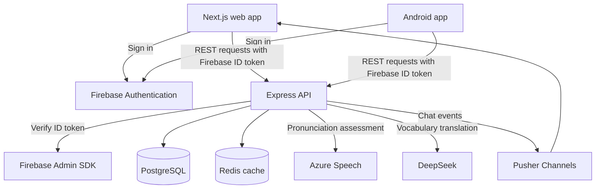

# EngFlex

EngFlex (formerly EngFlix) is an English learning platform built around videos and sentence-level practice. Learners can listen to short segments, complete dictation exercises, record shadowing attempts, review vocabulary, and track their progress.

This repository contains an Express API, a Next.js web application, and a native Android application. PostgreSQL stores application data; Firebase handles user authentication.

## Documentation

| Guide | What you will find |
| --- | --- |
| [Backend](Backend/readme.md) | Database setup, API configuration, migrations, Docker, and integrations |
| [Web application](frontend/README.md) | Next.js setup, Firebase configuration, routes, and production builds |
| [Android application](mobile/README.md) | Android Studio setup, emulator networking, Gradle builds, and API integration |

## System overview



Firebase authenticates users; it does not replace the application database. After sign-in, clients synchronize the user profile through `/api/v1/auth/sync` and send a Firebase ID token with protected API requests. The backend verifies the token and reads or updates PostgreSQL data.

Azure Speech powers pronunciation scoring. DeepSeek supplies English-to-Vietnamese vocabulary information. Redis caches backend queries, and Pusher delivers live chat events to the web client. Each integration has its own configuration in the component guides.

## Repository layout

```text
EngFlix/
├── Backend/       Express API, SQL migrations, and Docker configuration
├── frontend/      Next.js App Router application
└── mobile/        Android Gradle project; :app is the active module
```

The product name is **EngFlex**. Existing folder names, database names, and Android identifiers still use EngFlix in places; use the exact identifiers shown in the setup instructions.

## Features and clients

| Area | Implementation |
| --- | --- |
| Video learning | Lesson catalog, timed transcripts, segment playback, and dictation |
| Speaking practice | WAV recording, Azure pronunciation assessment, and attempt history |
| Vocabulary | System and personal decks, flashcards, quizzes, and review scheduling APIs |
| Learning records | Lesson progress, transcript completion, bookmarks, and notes |
| Community | Web pages and API support for posts, comments, likes, friends, and chat |
| Administration | Protected backend endpoints for content and dashboard management |

The clients have different coverage. The Android app focuses on study, vocabulary, notes, progress, and account settings. See each component guide before assuming a web feature is available on Android.

## Run locally

### 1. Prepare the shared services

You need Node.js and npm, PostgreSQL, and a Firebase project. The locked Next.js version requires Node.js **20.9.0 or later**. Android development additionally needs Android Studio, JDK 17, and Android SDK Platform 36.

Enable Email/Password authentication in Firebase. Enable Google sign-in if you plan to use it on the web. Configure both clients and the backend against the **same Firebase project**.

For a local PostgreSQL 15 database and Redis 7 instance:

```sh
cd Backend
docker compose up -d db redis
```

Compose exposes PostgreSQL on host port **5430** and Redis on **6379**. Follow the [backend guide](Backend/readme.md#configuration) to create `Backend/.env` and provide Firebase Admin credentials. No `.env.example` is included; copy the example from the guide.

### 2. Start the backend

From `Backend/`:

```sh
npm ci
npm run migrate
npm run dev
```

The guide uses `PORT=8000`. Check the migration output for errors before continuing, then open [Swagger UI](http://localhost:8000/api-docs).

### 3. Start the web application

Create `frontend/.env.local` using the [web configuration example](frontend/README.md#configuration). In another terminal, starting at the repository root:

```sh
cd frontend
npm ci
npm run dev
```

Open [the local web application](http://localhost:3000). The example web configuration points to `http://localhost:8000/api/v1`.

### 4. Run Android, if needed

Open `mobile/` in Android Studio. Configure `local.properties`, supply the matching Firebase `google-services.json`, sync Gradle, and run `:app`. The [Android guide](mobile/README.md) explains the required values and device setup.

## Local addresses

| Service | Address in this guide |
| --- | --- |
| Web application | `http://localhost:3000` |
| Backend API | `http://localhost:8000/api/v1` |
| Swagger UI | `http://localhost:8000/api-docs` |
| PostgreSQL from the host | `localhost:5430` |
| Redis from the host | `localhost:6379` |
| Backend from the Android emulator | `http://10.0.2.2:8000/api/v1/` |

The backend defaults to port **3000** when `PORT` is unset, and the full Compose backend also uses **3000**. Set `PORT=8000` for the host-based workflow above to leave port 3000 available for Next.js. The backend guide covers using the full Compose stack with the web app on another port.

## Verify the setup

1. Confirm migrations finish successfully and Swagger UI loads.
2. Register or sign in, then check that profile synchronization succeeds.
3. Browse topics and lessons. An empty database may have no learning content; no dedicated content-seeding command is configured.
4. With lesson content available, try a dictation exercise and check saved progress.
5. If Azure credentials are configured, record a pronunciation attempt and check the returned score.

The backend has no automated test script. The web app has lint and build commands, and Android contains the default example tests. Component guides describe the available checks and troubleshooting steps.

## Contributing

Make changes in the relevant component, verify its available checks, and update its README when configuration or behavior changes. Keep credentials in local configuration or deployment secrets. Use relative links in repository documentation so they work on other machines and on case-sensitive hosts.

No repository-wide license file is included. The backend package declares ISC in its package metadata; this does not establish a license for every component.
