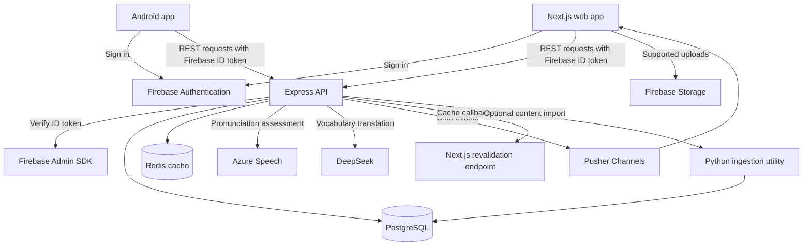
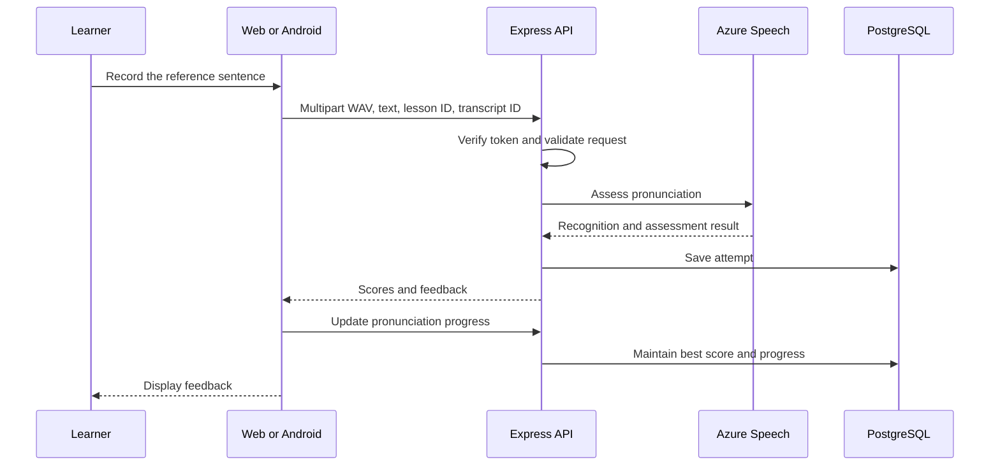

# EngFlex - Learn English Through Videos

EngFlex (formerly EngFlix) is an English learning platform built around videos and sentence-level practice. Learners can listen to short segments, complete dictation exercises, record shadowing attempts, review vocabulary, and track their progress.

This repository contains an Express API, a Next.js web application, and a native Android application. PostgreSQL stores application data; Firebase handles user authentication.

## Contents

- [Documentation](#documentation)
- [System overview](#system-overview)
- [Repository layout](#repository-layout)
- [Learning experience](#learning-experience)
- [Feature catalog](#feature-catalog)
- [Client feature coverage](#client-feature-coverage)
- [Technology stack](#technology-stack)
- [Component architecture and performance](#component-architecture-and-performance)
- [Core workflows](#core-workflows)
- [Data model](#data-model)
- [API overview](#api-overview)
- [Web routes](#web-routes)
- [Configuration map](#configuration-map)
- [Run locally](#run-locally)
- [Local addresses](#local-addresses)
- [Verify the setup](#verify-the-setup)
- [Development commands](#development-commands)
- [Deployment and implementation status](#deployment-and-implementation-status)
- [Troubleshooting](#troubleshooting)
- [Contributing](#contributing)
- [License](#license)

## Documentation

| Guide | What you will find |
| --- | --- |
| [Backend](Backend/readme.md) | Database setup, API configuration, migrations, Docker, and integrations |
| [Web application](frontend/README.md) | Next.js setup, Firebase configuration, routes, and production builds |
| [Android application](mobile/README.md) | Android Studio setup, emulator networking, Gradle builds, and API integration |
| [Web design system](frontend/UI_DESIGN_SYSTEM.md) | UI styling and component guidance |

## System overview



Firebase authenticates users; it does not replace the application database. After sign-in, clients synchronize the user profile through `/api/v1/auth/sync` and send a Firebase ID token with protected API requests. The backend verifies the token and reads or updates PostgreSQL data.

Azure Speech powers pronunciation scoring. DeepSeek supplies English-to-Vietnamese vocabulary information. Redis caches backend queries, and Pusher delivers live chat events to the web client. Each integration has its own configuration in the component guides.

## Repository layout

```text
EngFlix/
├── Backend/
│   ├── index.js                Express setup and route registration
│   ├── routes/                 HTTP routes and Swagger annotations
│   ├── middlewares/            Authentication, roles, errors
│   ├── controllers/            HTTP inputs and responses
│   ├── services/               Business logic and SQL
│   ├── db/                     PostgreSQL and Redis clients
│   ├── firebase/               Firebase Admin initialization
│   ├── migrations/             SQL schema changes
│   ├── scripts/                Migration runner
│   ├── config/                 Swagger configuration
│   ├── utils/                  Helpers and Python content importer
│   ├── Dockerfile
│   ├── docker-compose.yml
│   └── vercel.json
├── frontend/
│   ├── app/                    Routes, layouts, server endpoints
│   ├── components/             UI and feature workspaces
│   ├── hooks/                  Shared React hooks
│   ├── lib/                    APIs, Firebase, auth, WAV recorder
│   ├── services/               Domain API calls
│   ├── types/                  TypeScript models
│   └── public/                 Static assets
└── mobile/
    ├── app/
    │   ├── build.gradle.kts
    │   └── src/main/
    │       ├── AndroidManifest.xml
    │       ├── java/com/example/app/
    │       │   ├── adapter/
    │       │   ├── core/
    │       │   ├── data/        Local values, remote APIs, repositories
    │       │   ├── diaglog/     Existing dialog folder spelling
    │       │   ├── feature/     Active application screens
    │       │   └── utils/
    │       └── res/             Layouts, navigation, resources
    ├── gradle/                  Wrapper and version catalog
    └── settings.gradle.kts      Includes :app only
```

The product name is **EngFlex**. Existing folder names, database names, and Android identifiers still use EngFlix in places; use the exact identifiers shown in the setup instructions.

## Learning experience

1. **Discover:** browse topics and categories, search for a lesson, and inspect video metadata.
2. **Listen:** play the video and replay individual timed transcript segments.
3. **Practice dictation:** type or reconstruct what was heard, check the answer, and use hints when needed.
4. **Practice shadowing:** repeat the sentence, record it, and inspect pronunciation feedback.
5. **Collect vocabulary:** look up unfamiliar expressions and save them to personal decks.
6. **Review:** revisit flashcards, complete quizzes, inspect progress, and resume unfinished lessons.
7. **Connect:** share posts, comment, find friends, and participate in the web community chat.

The learning experience currently includes Vietnamese translations and interface text. English documentation does not imply that the application interface is fully translated into English.

## Feature catalog

### Accounts, authentication, and profiles

- Register and sign in with email/password through Firebase Authentication.
- Use Google sign-in in the web client.
- Synchronize authenticated users into PostgreSQL through `/api/v1/auth/sync`.
- Authenticate protected requests with Firebase ID tokens.
- Read and edit the current user's profile, update avatar URLs, and view public profiles.
- Use Firebase Storage from the web client for supported upload flows.
- Distinguish `user` and `admin` roles for administrative operations.
- Retrieve current tokens through client authentication helpers. The web API helper can retry a 401 response once with a forced refresh.

Firebase manages authentication identities. PostgreSQL stores application profiles, roles, learning records, and social data.

### Topics and lesson discovery

- Browse category/topic collections and lesson previews through an aggregated overview API.
- List lessons with pagination, category filtering, level filtering, and title search.
- View lesson details, video references, and ordered transcripts.
- Use web catalog controls to search, sort, and filter available lesson metadata.
- Choose a study mode when opening a lesson.
- Retrieve shared lesson content separately from the learner's authenticated study state.

### Video playback and transcripts

- Play YouTube-backed videos in the web and Android study interfaces.
- Navigate sentence by sentence using transcript order and timing information.
- Replay selected segments to focus on difficult lines.
- Change playback speed in the web study workspaces.
- Display transcript text and available translations.
- Restore saved progress and bookmarks when returning to a lesson.

Android embeds the player through a WebView and JavaScript bridge. The web client integrates playback into dedicated dictation and shadowing workspaces.

### Dictation

- Listen to a transcript segment and enter an answer in the web workspace.
- Check answers and move between sentences.
- Reveal one word or the full sentence as a hint.
- Use keyboard shortcuts and browser speech recognition input where supported.
- Reconstruct sentences through interactive word cards in the Android dictation flow.
- Save transcript completion, dictation status, and learning history through the API.
- Review a web lesson report and return to difficult material.
- Bookmark sentences and look up vocabulary while studying.

Browser speech recognition is an input aid that depends on browser support and permission. Azure pronunciation assessment is a separate workflow.

### Shadowing and pronunciation assessment

- Listen to a reference sentence, repeat it, and record an attempt.
- Capture mono, 16-bit PCM WAV audio at 16 kHz using the web recorder or Android `AudioRecord` implementation.
- Upload audio with reference text, lesson ID, and transcript ID.
- Assess speech with Azure Speech using `en-US`, a 100-point scale, phoneme granularity, and prosody assessment.
- Return overall, accuracy, fluency, completeness, and prosody scores when available.
- Show word-level feedback and weak phonemes in the web shadowing workspace.
- Store attempts and maintain the learner's best score per transcript.
- Delete assessment attempts through a protected endpoint.
- Save shadowing status and lesson-level pronunciation progress.
- Revisit weaker sentences through web practice and report actions.

The complete flow requires microphone permission and valid backend Azure credentials. Detailed feedback depends on recognized audio and the Azure response.

### Vocabulary lookup and collections

- Browse vocabulary categories and system-provided decks.
- Create, rename, and delete personal decks.
- Add, edit, and remove items in owned decks.
- Store phrases, normalized forms, meanings, usage notes, and example sentences.
- Store example translations and source-sentence context where supported by the data model.
- Request phonetics, Vietnamese meanings, usage notes, and bilingual examples through the AI translation endpoint.
- Save expressions encountered during web study into a personal collection.
- Enforce deck access and ownership checks on the backend.

The active translation service connects to DeepSeek using the OpenAI JavaScript client. Missing credentials or provider errors produce fallback content; a returned response is not always an AI-generated translation.

### Flashcards, quizzes, and review scheduling

- Review vocabulary through flashcards in both clients.
- Speak vocabulary aloud using browser text-to-speech in the web review flow where supported.
- Mark web flashcards as remembered or not yet remembered.
- Update review intervals, ease factors, correct/incorrect counters, and next review dates through the review API.
- Generate shuffled multiple-choice quizzes through the backend.
- Prefer personal vocabulary for quizzes, with public/sample vocabulary as fallback.
- Inspect quiz results and available word explanations in the web workspace.
- Include vocabulary totals and due-review counts in progress statistics.

The scheduling service increases intervals after successive correct reviews. An incorrect review resets the interval to one day and reduces the ease factor.

### Bookmarks and notes

- Bookmark a specific transcript sentence and attach a personal note.
- List saved notes across lessons or within one lesson.
- Edit note content and delete saved bookmarks.
- Search and paginate notes in the web workspace.
- Manage study notes through the Android note screens.

Bookmarks retain a link to the original transcript and lesson.

### Progress, history, and learner dashboard

- Record user/lesson history with separate dictation and pronunciation completion flags.
- Retrieve completed lessons, unfinished lessons, history summaries, and per-lesson summaries.
- Restore transcript completion, pronunciation progress, and bookmarks in returning sessions.
- Display web progress charts and Android completed/unfinished lesson lists.
- Calculate activity streaks from recorded study activity using Vietnam's timezone.
- Return a seven-day completed-lesson series and the latest ten pronunciation attempts for charts.
- Report personal vocabulary totals and review workload.

Progress statistics count a lesson as completed when both dictation and pronunciation flags are true. The current `total_minutes` value estimates **15 minutes per completed lesson**; it does not measure session duration.

### Community posts

- Publish posts and retrieve a community feed.
- View a user's posts through their profile wall.
- Delete owned posts.
- Toggle likes and read or add comments.
- Display user identity and profile information through shared web social components.

These features are implemented through the backend and web client. The active Android feature tree does not include corresponding community screens.

### Friends and community chat

- Search for users and send friendship requests.
- List incoming requests and accept or decline them.
- Retrieve friends and relationship status, and remove friendships.
- Load paginated chat messages and send new messages.
- Persist messages in PostgreSQL and publish live web updates through Pusher Channels.

Chat uses a shared community channel. The API does not define a separate private direct-message conversation system. Without Pusher configuration, stored messages can still be fetched, but live delivery is unavailable.

### Administration and content ingestion

- Protect administrative routes using Firebase verification and the `admin` role.
- Create, read, update, and delete lessons and categories.
- Create, update, and delete individual transcripts.
- Replace or bulk-add a lesson's transcript set.
- Manage vocabulary categories through admin endpoints.
- Request lesson creation from a YouTube URL through a Python import path.
- Notify the web cache revalidation endpoint after supported content changes.

The admin dashboard service currently returns sample statistics. Administrative content APIs exist independently of whether a matching web management screen is available.

The YouTube importer launches `python` and `Backend/utils/FetchTranscripts.py`. Its imports include `yt_dlp`, `youtube_transcript_api`, `psycopg2`, `openai`, and `dotenv`. This optional path requires a separately prepared Python environment, database access, DeepSeek configuration, and accessible transcripts. The Node-only Dockerfile does not install this environment.

## Client feature coverage

The clients have different coverage. The Android app focuses on study, vocabulary, notes, progress, and account settings.

| Capability | Web | Android | Backend |
| --- | --- | --- | --- |
| Email/password authentication | Implemented | Implemented | Token verification and profile sync |
| Google sign-in | Implemented | No equivalent active auth flow documented | Verifies Firebase-issued tokens |
| Lesson and transcript study | Implemented | Implemented | Catalog, content bundle, study state |
| Dictation | Text entry, hints, keyboard controls | Word-card exercises | Completion and history storage |
| Pronunciation | Dedicated workspace and detailed feedback | Recording in listening screen | Azure assessment, attempts, best scores |
| Personal decks and flashcards | Implemented | Implemented | Deck/item access and mutations |
| Vocabulary quiz | Dedicated quiz workspace | Learning screens have different coverage | Multiple-choice quiz generation |
| Review scheduling results | Web flashcard integration | No equivalent integration documented | Review endpoint and scheduling |
| Notes and progress | Implemented | Implemented | Bookmarks, history, statistics |
| Posts, friends, chat | Implemented | No corresponding active screens | Social APIs and Pusher events |
| Content administration | No complete management UI assumed | No management UI | Role-protected content operations |

## Technology stack

### Backend and infrastructure

| Technology | Purpose |
| --- | --- |
| Node.js / CommonJS | JavaScript runtime and module system |
| Express 5 | REST routing and middleware |
| PostgreSQL / `pg` | Relational storage, pooling, direct SQL |
| SQL migrations | Schema changes tracked in `schema_migrations` |
| Firebase Admin SDK | Client ID-token verification |
| Azure Speech SDK | Recognition and pronunciation assessment |
| OpenAI JavaScript client / DeepSeek | AI vocabulary lookup and translation |
| Multer | Multipart WAV uploads |
| Redis client / Redis 7 | Cache for selected API reads |
| Pusher server SDK | Community chat events |
| Swagger JSDoc / Swagger UI | OpenAPI generation and interactive docs |
| `cors`, `compression`, `dotenv` | Cross-origin middleware, compression, environment loading |
| Nodemon | Development reloads |
| Docker / Docker Compose | Development API, PostgreSQL 15, and Redis services |
| Vercel configuration | Express deployment entry point and routing |
| Python utility | Optional YouTube metadata/transcript ingestion |

Azure Vision packages are declared in the backend manifest, but no active image-analysis feature is exposed. Installed packages should not be interpreted as implemented product features.

### Web application

| Technology | Purpose |
| --- | --- |
| Next.js 16.2.10 / App Router | Routes, layouts, server rendering, tagged content caching |
| React 19.2.4 / TypeScript 5 | Components, state, shared models |
| Tailwind CSS 4 / PostCSS | Styling and CSS processing |
| shadcn / Base UI | Reusable interface components |
| Motion / `tw-animate-css` | Interface animation |
| Lucide React / Sonner | Icons and notifications |
| `next-themes` | Theme management |
| Axios / `fetch` | Authenticated requests and public content loading |
| TanStack Query / TanStack Table | Query-state and table utilities |
| DnD Kit | Drag-and-drop interaction support |
| Recharts | Learning charts |
| Firebase Client SDK | Authentication and Storage |
| Pusher JS | Live chat subscriptions |
| Web Audio / browser speech APIs | Recording, speech input, text-to-speech where supported |
| Zod | Schema validation utilities |
| ESLint 9 / Next.js ESLint configuration | Static checks |

Supporting styling packages include `clsx`, `class-variance-authority`, and `tailwind-merge`. Manifests and lockfiles record dependency declarations and resolved versions.

### Android application

| Technology | Purpose |
| --- | --- |
| Java 11 source compatibility | Application code; Gradle scripts use Kotlin DSL |
| Android Gradle Plugin 8.13.2 / Gradle 8.13 | Build tooling |
| Compile/target SDK 36 / minimum API 24 | Platform configuration |
| XML / View Binding | Native layouts and view access |
| Material Components / ConstraintLayout / CardView | UI components and layout |
| Fragments / Navigation | Lifecycle and screen navigation |
| RecyclerView adapters / ViewPager2 / FlexboxLayout | Lists, tabs, word-card layouts |
| ViewModel / LiveData libraries | Available lifecycle-aware tools; usage varies by screen |
| Retrofit 2 / OkHttp 4 / Gson | HTTP interfaces, interception, JSON models |
| Firebase Auth | Registration, sign-in, current ID tokens |
| SharedPreferences | Local token storage through `TokenManager` |
| WebView / JavaScript bridge | YouTube playback and segment control |
| AudioRecord | PCM capture and WAV packaging |
| Glide / CircleImageView | Image loading and avatar presentation |
| JUnit / AndroidX Test / Espresso | Existing example test infrastructure |

Use JDK 17 to run the Android build; Java 11 is the source/target compatibility setting. Firestore and CameraX dependencies are also declared, but do not establish an offline Firestore mode or camera-based learning feature.

## Component architecture and performance

### Backend

Requests pass through **routes → middleware → controllers → services → database or external services**. Controllers handle HTTP inputs and responses; services contain business logic and SQL. There is no ORM layer. Middleware handles authentication, role checks, and centralized errors.

Public catalog routes allow browsing where configured. Personal records, notes, mutations, social actions, and administration require authentication and applicable ownership or role checks.

### Web

App Router groups separate the main product layout from focused study screens. Shared UI lives in `components/`, domain API access in `services/`, and API/auth utilities in `lib/`. Public server requests use `lib/public-api.ts`; authenticated browser requests use the Axios helper in `lib/api-client.ts`.

### Android

The active `:app` module contains Fragments, adapters, repositories, Retrofit APIs, and models. It combines direct Fragment-to-repository calls with available lifecycle libraries, rather than using a uniform MVVM structure. Top-level `mobile/core/` and `mobile/feature/` folders are outside the active module.

### Caching and query performance

- Redis caches selected category, lesson, and topic reads.
- Public web requests support Next.js cache tags and revalidation options.
- Backend content changes can call `POST /api/cache/revalidate` using a shared server-only secret.
- Authenticated backend responses receive private/no-store cache headers.
- Aggregated content and study-state endpoints reduce separate lesson startup requests.
- SQL indexes support catalog browsing, transcript order, history, pronunciation, and review queries.
- Compression and paginated list APIs reduce transfer and query costs where implemented.

## Core workflows

### Sign-in and synchronization

1. Sign in through Firebase Authentication and obtain an ID token.
2. Send it to `POST /api/v1/auth/sync`.
3. Firebase Admin verifies the identity; the backend synchronizes the PostgreSQL profile.
4. Send protected requests with `Authorization: Bearer <ID_TOKEN>`.
5. Services enforce applicable ownership and role rules.

A refresh token cannot replace an ID token in API requests. Both clients and Firebase Admin must use the same Firebase project.

### Study and progress

1. Browse topics/categories and select a lesson.
2. Fetch `/api/v1/lessons/:lessonId/content` for lesson, category, and transcript data.
3. Load `/api/v1/lessons/:lessonId/study-state?mode=dictation` or `?mode=shadowing` with authentication for progress and bookmarks.
4. Practice sentences through dictation or shadowing.
5. Submit completion, pronunciation, and history updates.
6. Reopen the lesson or progress screen to retrieve saved records.

### Pronunciation assessment



### Vocabulary review

1. Select an expression or create an item manually.
2. Optionally request DeepSeek vocabulary information through the backend.
3. Save the item to an owned deck.
4. Practice with flashcards or a quiz.
5. Submit remembered/not-remembered results from web flashcards to update scheduling.
6. Inspect vocabulary totals and due-review counts before another session.

## Data model

PostgreSQL is the central application store. Firebase UIDs link profiles to learning and social activity.

| Domain | Main tables | Information |
| --- | --- | --- |
| Accounts | `users` | Firebase-linked profile, role, contact fields, level, badge |
| Content | `categories`, `lessons`, `transcripts` | Organization, video references, timed sentences |
| Notes | `transcript_bookmarks` | Saved sentences and personal notes |
| Learning | `transcript_progress`, `learning_history` | Sentence completion and lesson history |
| Exercise state | `dictation_status`, `shadowing_status` | Completion by practice mode |
| Pronunciation | `pronunciation_attempts`, `pronunciation_progress` | Metrics, feedback, transcript best scores |
| Vocabulary | `vocabulary_categories`, `vocabulary_decks`, `vocabulary_items` | Collections, item content, scheduling |
| Community | `posts`, `post_likes`, `post_comments` | Feed and interactions |
| Relationships | `friendships` | Requests and accepted relationships |
| Chat | `chat_messages` | Shared-channel messages |
| Schema history | `schema_migrations` | Applied SQL filenames |

A category contains lessons, and each lesson contains transcripts. Users attach progress, notes, and attempts to that content. Personal vocabulary decks belong to users and contain items.

Migrations define constraints, foreign keys, and indexes. Migration 014 migrates and drops the legacy `bookmarks` table. Both `013_` files are separate migrations and must be retained. No dedicated seed or rollback command is configured.

Android stores small local values in SharedPreferences and has no configured Room/SQLite business-data layer. The application currently depends on online backend access.

## API overview

The base path is `/api/v1`. Swagger UI is served at `/api-docs`, with detailed annotations in route files.

| Prefix | Responsibilities |
| --- | --- |
| `/auth` | API login, profile sync, own/public profiles, profile/avatar updates |
| `/topics` | Aggregated category and lesson previews |
| `/categories` | Category listing |
| `/lessons` | Search, filters, details, transcripts, content bundle, study state |
| `/transcripts` | Mounted placeholder router with no active handlers; use lesson transcript reads and admin transcript operations |
| `/transcript-bookmarks` | List, create, edit, delete saved notes |
| `/transcript-progress` | Read/write completed transcripts |
| `/learning-history` | History, finished/unfinished lessons, summaries |
| `/dictation-status`, `/shadowing-status` | Read/save exercise state |
| `/vocabulary-categories` | Browse categories, translate expressions, generate quizzes |
| `/vocabulary-decks` | System/personal decks, item operations, review results |
| `/pronunciation-attempts`, `/pronunciation` | WAV assessment, attempt deletion, progress |
| `/progress` | Learning statistics through `/stats` |
| `/posts` | Feed, user wall, posts, likes, comments |
| `/friendships` | Search, requests, acceptance, status, removal |
| `/chat` | Read/send community messages |
| `/admin` | Role-protected dashboard and content-management routes |

These are route groups, not identical CRUD resources. Check individual methods and access requirements in Swagger or the source. Administrative lesson, category, transcript, and vocabulary-category routes are nested under `/admin`.

## Web routes

| Route | Screen or responsibility |
| --- | --- |
| `/` | Landing page |
| `/login`, `/signup` | Authentication |
| `/dashboard` | Learner dashboard |
| `/topics`, `/topics/[categoryId]` | Catalog and category lessons |
| `/lessons/[lessonId]/dictation` | Dictation workspace |
| `/lessons/[lessonId]/shadowing` | Shadowing workspace |
| `/vocabulary`, `/vocabulary/quiz` | Vocabulary and quiz |
| `/notes`, `/progress` | Notes and progress |
| `/community`, `/friends`, `/chat` | Social screens |
| `/profile/[userId]` | Profile page |
| `/api/cache/revalidate` | Server cache invalidation endpoint |

## Configuration map

| Component | Location | Key settings |
| --- | --- | --- |
| Backend | `Backend/.env` | `PORT`, `DATABASE_URL` or `DB_*`, `REDIS_URL`, Firebase and service credentials |
| Firebase Admin | Backend environment or `Backend/serviceAccountKey.json` | Service account for verification |
| Web | `frontend/.env.local` | `NEXT_PUBLIC_API_URL`, four `NEXT_PUBLIC_FIREBASE_*` values, optional public Pusher values |
| Android | `mobile/local.properties` | `sdk.dir`, `FIREBASE_API_KEY`, `BASE_URL` |
| Android Firebase | `mobile/app/google-services.json` | Configuration matching the application ID |
| Pronunciation | Backend environment | `AZURE_SPEECH_KEY`, `AZURE_SPEECH_REGION` |
| Translation | Backend environment | `DEEPSEEK_API_KEY` |
| Live chat | Backend and web | Backend `PUSHER_APP_ID`, `PUSHER_KEY`, `PUSHER_SECRET`, `PUSHER_CLUSTER`; matching public web key/cluster |
| Cache invalidation | Backend and web | Backend `FRONTEND_REVALIDATE_URL`; matching `CACHE_REVALIDATE_SECRET` |

Firebase Admin checks a full `FIREBASE_SERVICE_ACCOUNT` JSON value, individual Admin fields, then the local service account file. Component guides provide complete examples and precedence rules.

Web `NEXT_PUBLIC_*` values are public build-time configuration. Android `BuildConfig` values are compiled into the app. Keep Admin credentials and third-party secrets on the backend.

## Run locally

### 1. Prepare the shared services

You need Node.js and npm, PostgreSQL, and a Firebase project. The locked Next.js version requires Node.js **20.9.0 or later**. Android development additionally needs Android Studio, JDK 17, and Android SDK Platform 36.

Enable Email/Password authentication in Firebase. Enable Google sign-in if you plan to use it on the web. Configure both clients and the backend against the **same Firebase project**.

For a local PostgreSQL 15 database and Redis 7 instance:

```sh
cd Backend
docker compose up -d db redis
```

Compose exposes PostgreSQL on host port **5430** and Redis on **6379**. Follow the [backend guide](Backend/readme.md#configuration) to create `Backend/.env` and provide Firebase Admin credentials. No `.env.example` is included; copy the example from the guide.

### 2. Start the backend

From `Backend/`:

```sh
npm ci
npm run migrate
npm run dev
```

The guide uses `PORT=8000`. Check the migration output for errors before continuing, then open [Swagger UI](http://localhost:8000/api-docs).

### 3. Start the web application

Create `frontend/.env.local` using the [web configuration example](frontend/README.md#configuration). In another terminal, starting at the repository root:

```sh
cd frontend
npm ci
npm run dev
```

Open [the local web application](http://localhost:3000). The example web configuration points to `http://localhost:8000/api/v1`.

### 4. Run Android, if needed

Open `mobile/` in Android Studio. Configure `local.properties`, supply the matching Firebase `google-services.json`, sync Gradle, and run `:app`. The [Android guide](mobile/README.md) explains the required values and device setup.

## Local addresses

| Service | Address in this guide |
| --- | --- |
| Web application | `http://localhost:3000` |
| Backend API | `http://localhost:8000/api/v1` |
| Swagger UI | `http://localhost:8000/api-docs` |
| PostgreSQL from the host | `localhost:5430` |
| Redis from the host | `localhost:6379` |
| Backend from the Android emulator | `http://10.0.2.2:8000/api/v1/` |

The backend defaults to port **3000** when `PORT` is unset, and the full Compose backend also uses **3000**. Set `PORT=8000` for the host-based workflow above to leave port 3000 available for Next.js. The backend guide covers using the full Compose stack with the web app on another port.

## Verify the setup

1. Confirm migrations finish successfully and Swagger UI loads.
2. Register or sign in, then check that profile synchronization succeeds.
3. Browse topics and lessons. An empty database may have no learning content; no dedicated content-seeding command is configured.
4. With lesson content available, try a dictation exercise and check saved progress.
5. If Azure credentials are configured, record a pronunciation attempt and check the returned score.

The backend has no automated test script. The web app has lint and build commands, and Android contains the default example tests. Component guides describe the available checks and troubleshooting steps.

## Development commands

Run commands from the relevant component directory. No root workspace script coordinates the three applications.

| Component | Command | Purpose |
| --- | --- | --- |
| Backend | `npm ci` | Install locked dependencies |
| Backend | `npm run dev` | Start Express with Nodemon |
| Backend | `npm run migrate` | Apply pending migrations |
| Backend | `node index.js` | Start Express directly |
| Backend | `docker compose up --build -d` | Start the development stack |
| Web | `npm run dev` | Start Next.js development server |
| Web | `npm run lint` | Run ESLint |
| Web | `npm run build` | Create a production build |
| Web | `npm run start` | Serve an existing production build |
| Android | `.\gradlew.bat assembleDebug` | Build a debug APK on Windows |
| Android | `.\gradlew.bat testDebugUnitTest` | Run local example tests |
| Android | `.\gradlew.bat lintDebug` | Run Android lint |
| Android | `.\gradlew.bat connectedDebugAndroidTest` | Run instrumented tests on a device |

On macOS/Linux, replace `.\gradlew.bat` with `./gradlew`. Debug APK output is `mobile/app/build/outputs/apk/debug/app-debug.apk`.

## Deployment and implementation status

### Deployment paths

- **Backend:** `vercel.json` routes requests to the exported Express app. Configure external PostgreSQL, Firebase Admin, and required service credentials in the deployment environment. Apply migrations separately.
- **Web:** build and serve Next.js with the correct API URL and public Firebase configuration. The API must be reachable from the Next.js server and browsers. Authorize the deployed web hostname in Firebase.
- **Android:** build with the target backend URL and matching Firebase configuration. Configure signing before distributing a release.
- **Development containers:** Compose supplies PostgreSQL 15, Redis 7, and an optional backend container. Its Dockerfile uses Node 18 and Nodemon; the web package requires Node 20.9.0 or later.

### Current boundaries

| Area | Current state |
| --- | --- |
| Tests | No backend or web automated test script; Android has standard example tests. |
| Migration failures | Logged errors do not reliably produce a failing exit status. Inspect logs and applied records. |
| Initial content | No dedicated seeding command; prepare lesson and vocabulary content separately. |
| Admin analytics | Dashboard statistics are sample values. Content management uses separate APIs. |
| Learning time | Minutes are estimated from completed lessons. |
| Offline use | No configured offline business-data synchronization layer. |
| Client parity | Web has social features and study tools not all present on Android. |
| External AI | Pronunciation and real translations depend on credentials and service availability. |
| YouTube import | Needs Python packages absent from the standard Node container. |
| Android release | Signing is unconfigured; release minification is disabled. |
| Swagger server | Request configuration points to localhost:8000 even when Compose exposes the API on 3000. |

## Troubleshooting

| Symptom | First checks |
| --- | --- |
| Backend fails at startup | Supply valid Firebase Admin credentials and inspect logs. |
| Web and API compete for port 3000 | Use host backend port 8000, or start Next.js on 3001 alongside full Compose. |
| PostgreSQL connection refused | Use `localhost:5430` from the host or `db:5432` from the backend container. |
| Database settings appear ignored | Check `DATABASE_URL`, which overrides `DB_*`. |
| Tables missing after migrations | Inspect the logged error and `schema_migrations`. |
| Repeated Redis errors | Start Redis and confirm `REDIS_URL`. |
| Sign-in works but protected requests fail | Check ID tokens, Firebase project alignment, and profile sync. |
| Android cannot reach the API | Use `10.0.2.2` for the standard emulator or the computer's LAN address for a real device. |
| Recording fails | Grant microphone permission; use localhost or HTTPS on the web. |
| Pronunciation returns no score | Check WAV format, multipart fields, reference text, and Azure credentials. |
| Translation returns generic content | Check DeepSeek credentials and provider logs. |
| Chat updates only after refresh | Configure matching backend and web Pusher values. |
| Edited content stays stale | Check the revalidation URL, matching secret, and accepted cache tags. |

## Contributing

Make changes in the relevant component, verify its available checks, and update its README when configuration or behavior changes. Keep credentials in local configuration or deployment secrets. Use relative links in repository documentation so they work on other machines and on case-sensitive hosts.

## License

No repository-wide license file is included. The backend package declares ISC in its package metadata; this does not establish a license for every component.
